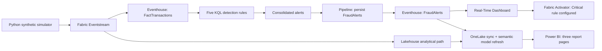

# Real-Time Banking Fraud Analytics

**Microsoft Fabric · Eventstream · Eventhouse/KQL · Lakehouse · Power BI · Python**

An end-to-end **synthetic-data** banking fraud-risk analytics portfolio project with five explainable KQL detection rules, a three-page Power BI report, a separate rolling-hour operational dashboard, and a configured Fabric Activator rule.

> **Disclaimer:** All customers and transactions are synthetic. Alerts are rule-based risk indicators—not confirmed fraud. This is not a production transaction-blocking system.

## Project snapshot

| Item | Baseline |
|---|---|
| Historical period | July–September 2026 |
| Historical transactions | **240,000** (July 68,400; August 77,600; September 94,000) |
| Synthetic customers / Indian locations | **10,000 / 105** |
| Injected anomaly cases | **9,678 (4.03%)** |
| Fraud-risk detection | **5** KQL scenarios |
| Reporting | **3** Power BI pages and a separate last-hour Real-Time Dashboard |

**Count boundary:** The 9,678 cases are **simulator-injected anomalies**, **not** KQL-generated or persisted `FraudAlerts`. The populations are different.

## Business objective

Detect and explain potentially suspicious banking transaction patterns; prioritize investigation by severity, customer, location and channel; estimate potential INR exposure; and distinguish historical risk analysis from recent operational monitoring.

## Microsoft Fabric architecture



Pipeline execution order: `Update_Live_Transaction_Dimensions` → `Persist_Live_Fraud_Alerts` → `Wait_For_OneLake_Sync` (300 seconds) → `Refresh_Banking_Analytics_Model`.

## Implemented detection scenarios

| Scenario | Rule |
|---|---|
| **High Velocity** | ≥3 transactions per customer in a fixed 2-minute window; 4–5 Severe; ≥6 Critical |
| **Spending Burst** | ≥3 transactions in 15 minutes, total ≥₹50,000; ≥₹75,000 Severe; ≥₹1,00,000 Critical |
| **Unusual High Value** | Net Banking **Fund Transfers only**; amount >₹25,000 and ≥2× prior comparable average; severity depends on transaction history and ratio |
| **Unusual Transaction Time** | 00:00–05:00 IST; one in 30-minute window Suspicious, ≥2 Severe |
| **Impossible Travel** | Consecutive customer transactions ≥500 km apart within ≤30 minutes; ≥800 km or ≤15 minutes Severe |

Two or more **distinct** scenarios on one consolidated event escalate final severity to **Critical**. The consolidated alert uses the **maximum** applicable scenario exposure, not the sum of overlapping exposures. [Exact KQL](kql/06_Final_FraudAlerts_Updated.kql).

## Power BI report

The historical/analytical report contains **Fraud Overview** (management KPIs and trends), **Fraud Investigation** (critical cases, scenarios and investigation details), and **Risk Patterns** (geographic map, state/city rankings, channel risk and weekly patterns).

The companion project archive contains six report screenshots, including July–September and later July–November simulated reporting states. Later-state figures must not be mistaken for the historical baseline.

## Real-Time Dashboard

`RealTime_Banking_Fraud_Monitoring` shows five rolling **last-hour** KPIs:

**Total Transactions · Fraud Alerts · Critical Alerts · Potential Fraud Exposure (INR) · Alert Rate (%)**

Its investigation table displays **Alert ID, Transaction ID, Customer ID, Transaction Location, Amount (INR), Fraud Scenario, Severity and Alert Reason**. Severity colors: Critical red, Severe yellow, Suspicious blue.

- **Alert Rate:** distinct flagged transaction IDs ÷ transactions in the **same time window** × 100.
- **Potential Fraud Exposure:** rule-derived estimated exposure, **not actual loss**.
- **Live Refresh:** re-runs dashboard queries; it does not generate transactions or guarantee new persisted alerts.

## Source and documentation

| Path | Purpose |
|---|---|
| [`python/RealTime_Banking_Fraud_FINAL.py`](python/RealTime_Banking_Fraud_FINAL.py) | **User-confirmed final** historical/live synthetic simulator |
| [`python/generate_dim_customer_FINAL.py`](python/generate_dim_customer_FINAL.py) | Deterministic synthetic customer generator |
| [`python/generate_dim_location_FINAL.py`](python/generate_dim_location_FINAL.py) | Indian location reference generator |
| [`kql/06_Final_FraudAlerts_Updated.kql`](kql/06_Final_FraudAlerts_Updated.kql) | Five KQL rules and consolidated alert logic |
| [`kql/07_Persist_FraudAlerts_Updated.kql`](kql/07_Persist_FraudAlerts_Updated.kql) | Persist consolidated alerts |
| [`docs/Final_BRD.md`](docs/Final_BRD.md) | Full business requirements in readable Markdown |
| [`docs/README.md`](docs/README.md) | Business scope and validation notes |
| [`python/requirements.txt`](python/requirements.txt) | Python dependencies |

The **synthetic dimension CSVs and a 200-row transaction sample** are available in [data/](data/), and the [BRD is readable online](docs/Final_BRD.md). The formatted DOCX, PBIX and 10 project screenshots are supplied in the companion archive for repository upload.

### Run the simulator locally

```bash
python -m pip install -r python/requirements.txt
python python/RealTime_Banking_Fraud_FINAL.py
```

Select the two synthetic dimension CSVs when prompted and supply your Fabric Eventstream connection string **privately**. **Option 1** sends the July–September 2026 historical synthetic transactions (240,000); **Option 2** sends controlled live-mode synthetic transactions beginning October 2026. The stream is simulated; no real bank events are used. Rerunning can resend events.

**KQL safety:** `07_Persist_FraudAlerts_Updated.kql` uses `.set-or-replace FraudAlerts`, which **replaces the existing persisted table**. Review the output before running it in your own development Eventhouse.

## Verification boundary

- Fabric Activator rule `Critical_Fraud_Email_Alert` was configured, but **successful email delivery and new-only behavior were not verified**.
- Current persisted alert totals must be checked in Eventhouse before publication; do not equate them with the 9,678 injected anomaly cases.
- No machine learning, confirmed fraud, real customer data, guaranteed 24/7 service, regulatory certification, production-grade SLA, or transaction blocking is claimed.
- Local Power BI paths, Fabric assets and Eventstream connections require reconfiguration for reproduction.

## Acknowledgments

- **[Mansi Goel](https://www.linkedin.com/in/mansigoelofficial/)** — data analytics, SQL, Power BI and career-development learning resources.
- **[Santosh Avalamurthy](https://www.linkedin.com/in/santosh-avalamurthy-mct-msfabric-mspowerbi-coach-trainer/)** — Microsoft Fabric and Power BI training resources.

Independent portfolio implementation; these acknowledgments do **not** imply development, review or endorsement by either individual.

---
*Educational synthetic-data project. Alerts indicate investigation priorities; potential exposure is not realized loss.*
