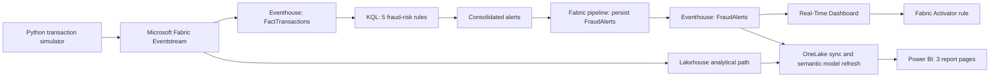

# Real Time Banking Fraud Analytics

**Microsoft Fabric | Eventstream | Eventhouse & KQL | Lakehouse | Power BI | Python**

An end-to-end banking fraud-risk analytics portfolio project that connects a **Python transaction simulator** to Microsoft Fabric, applies **five explainable fraud-risk rules**, and presents historical and recent alerts through Power BI and a separate Real-Time Dashboard.

**All transactions and customers are synthetic.** Alerts are risk indicators for investigation, not confirmed fraud or actual financial losses.

## 1. Project overview

The goal was to understand the complete analytical workflow, not just build a dashboard: generate data, stream events, identify suspicious patterns, persist alerts, analyze business risk and make cases easier to investigate.

**Business questions**
- When and where are fraud-risk alerts being triggered?
- Which transaction patterns produce Critical or multi-scenario alerts?
- Which channels, cities and states account for the highest alert counts and potential exposure?
- How do transaction volume and alert rates change over time?
- What can investigators see about an individual flagged transaction?

## 2. Project snapshot

| Metric | July–September 2026 historical simulation | July–November 2026 extended synthetic test |
|---|---:|---:|
| Transactions | **240,000** | **409,000** |
| Synthetic customers | **10,000** | **10,000** |
| Fraud-risk alerts shown in Power BI | **9,678** | **16,244** |
| Flagged transaction rate | **4.03%** | **3.97%** |
| Transaction amount | **₹245.55 Cr** | **₹394.73 Cr** |
| Estimated potential fraud exposure | **₹26.81 Cr** | **₹45.28 Cr** |
| Critical alerts | **1,440** | **2,465** |
| Multi-scenario alerts | **480** | **796** |

**Coverage:** **105** synthetic Indian locations; the report includes state, city and date filters.

The extended simulation includes **future-dated November 2026 test records**. These are controlled synthetic scenarios, not live observations of future real-world transactions.

## 3. Tools and architecture

| Technology | What it does in this project |
|---|---|
| **Python in VS Code** | Generates historical and live-mode synthetic banking transactions and reference dimensions |
| **Fabric Eventstream** | Receives and routes transaction events |
| **Eventhouse / KQL** | Queries transactions, applies five detection rules and consolidates alert details |
| **Fabric pipelines** | Orchestrate dimension updates, alert persistence, OneLake synchronization and semantic model refresh |
| **Lakehouse / semantic model** | Supports analytical reporting in Power BI |
| **Power BI** | Provides Fraud Overview, Fraud Investigation and Risk Patterns |
| **Fabric Real-Time Dashboard** | Monitors the latest one-hour window of transactions and flagged events |
| **Fabric Activator** | Critical-alert notification rule configured; successful email delivery not yet verified |



### Fabric workspace and architecture

The workspace brings together the streaming, storage, orchestration, querying and reporting components used in the project.


### Eventstream: transaction ingestion

The Eventstream routes simulated transaction events to the downstream Fabric destinations for querying and analysis.


### Pipeline: persistence and reporting refresh

The pipeline coordinates **dimension updates → persisted fraud alerts → a 300-second OneLake sync wait → semantic model refresh**. Refreshing a report is separate from generating new transactions.


## 4. Fraud detection logic

| Detection rule | What is flagged |
|---|---|
| **High Velocity** | At least 3 transactions by a customer in a fixed 2-minute window |
| **Spending Burst** | At least 3 transactions in 15 minutes totaling at least ₹50,000 |
| **Unusual High Value** | Net Banking fund transfers over ₹25,000 and at least 2× the customer's comparable prior average |
| **Unusual Transaction Time** | Transactions between 00:00 and 05:00 IST |
| **Impossible Travel** | Consecutive customer transactions at least 500 km apart within 30 minutes |

A transaction can trigger more than one distinct rule. The KQL consolidates matching scenarios, escalates **two or more distinct scenarios to Critical**, and uses the **maximum applicable scenario exposure within an alert** to avoid adding overlapping amounts. The rules are explainable, deterministic KQL logic, **not a machine-learning model**.

[View the complete KQL detection logic](kql/06_Final_FraudAlerts_Updated.kql).

## 5. Power BI dashboard pages

The report has three connected pages with **state, city and date filters**, KPI cards, trends, rankings and investigation details. Both historical and extended synthetic screenshots are included below.

### Page 1: Fraud Overview

**What it shows:** Total transactions, customers, risk alerts, transaction amount, estimated potential exposure and flagged rate. Charts compare severity, monthly/daily trends, gender, age, transaction types, scenarios and payment channels.

| Historical view: July–September 2026 | Extended synthetic view: July–November 2026 |
|:---:|:---:|
|  |  |

**Insight:** September had the highest historical alert count (**3,807**), but August had the highest alert rate (**4.12%**). This is why alert counts should be compared against transaction volumes, not interpreted alone.

### Page 2: Fraud Investigation

**What it shows:** Critical alerts, multi-scenario alerts, critical and multi-scenario exposure, scenario comparisons, alert trends and a case-level investigation table with customer, city, channel, scenario and potential exposure.

| Historical view: July–September 2026 | Extended synthetic view: July–November 2026 |
|:---:|:---:|
|  |  |

**Insight:** The extended dashboard shows **2,465 Critical alerts** and **796 multi-scenario alerts**. Multi-scenario cases are especially relevant for investigation because multiple independent rules can describe the same flagged event.

### Page 3: Risk Patterns

**What it shows:** State and city rankings, a geographic risk map, customer alert frequency, hourly alert trends, weekly transaction/exposure comparisons and a scenario-by-channel heatmap.

| Historical view: July–September 2026 | Extended synthetic view: July–November 2026 |
|:---:|:---:|
|  |  |

**Insight:** **Maharashtra** leads the extended state alert count (**1,286**); **New Delhi** leads city alert count (**476**); **Bengaluru** leads city-level potential exposure (**₹1.42 Cr**). The city with the most alerts is not necessarily the city with the highest exposure.

## 6. Real-Time Fraud Monitoring Dashboard

Separate from the three-page Power BI report, this Fabric dashboard monitors a **rolling last-hour window**. It displays five operational KPIs and a transaction-level investigation table.


**Screenshot snapshot:** **282 transactions | 14 alerts | 1 Critical alert | ₹310.3K potential exposure | 4.96% alert rate**.

The table shows **Alert ID, Transaction ID, Customer ID, transaction location, amount, fraud scenario, severity and alert reason**. These values describe **one captured hour**, not a continuously guaranteed alert rate or lifetime total.

## 7. Key analytical findings

1. **Alert counts and alert rates differ.** September recorded **3,807** alerts; August had the higher normalized rate of **4.12%**.
2. **Channel activity and monetary value differ.** In the inspected 240,000-row historical CSV, **UPI represented 44.19% of transactions but 20.46% of transaction value**.
3. **Critical alerts need scenario context.** The extended dashboard shows **796 multi-scenario alerts** alongside **2,465 Critical alerts**.
4. **Geography matters differently for counts and exposure.** Maharashtra has the highest state alert count, while Bengaluru leads city-level potential exposure in the extended synthetic view.
5. **Data quality and KPI reconciliation matter.** The historical CSV has **240,000 unique transaction IDs** and **no missing values across the 10 transaction fields**. Some extended report exposure breakdowns still need reconciliation with their headline KPI; these checks are documented rather than hidden.

[**Read the full business insights and calculations**](docs/INSIGHTS.md) | [**Validation and open checks**](docs/VALIDATION.md)

## 8. Features and learnings

- Designed a synthetic historical and controlled live-mode transaction simulator with customer and location reference data.
- Applied customer-level KQL aggregations, time windows, IST conversion and location-distance checks.
- Consolidated overlapping scenarios into investigation-ready alerts with severity rules.
- Connected event ingestion, persistence, OneLake synchronization and Power BI refresh.
- Built three Power BI analytical pages and a separate last-hour operational dashboard.
- Configured a Critical-alert rule in Fabric Activator; email delivery remains unverified.
- Used **ChatGPT to assist Python simulator development and debugging in VS Code**, while focusing on validating outputs and understanding the Fabric and fraud-rule integration.

[**Read the challenges and lessons learned**](docs/CHALLENGES_AND_LEARNINGS.md).

## 9. Project files

Every project folder has a short index with file explanations and a **Back to Main README** link.

| Section | Contents |
|---|---|
| [**Python**](python/README.md) | Final simulator, customer/location generators and dependencies |
| [**KQL**](kql/README.md) | Five fraud-risk detection rules and alert persistence scripts |
| [**Data**](data/README.md) | Synthetic customer and location dimensions plus a 200-row transaction sample |
| [**Documentation**](docs/README.md) | BRD, business insights, validation and technical learnings |
| [**Reports**](reports/README.md) | Three Power BI report pages and current PBIX status |
| [**Screenshots**](screenshots/README.md) | All 10 screenshots and page-by-page image navigation |
| [**Power BI screenshots**](screenshots/power-bi/README.md) | Six report images covering three pages |
| [**Fabric screenshots**](screenshots/fabric/README.md) | Four architecture, pipeline and monitoring images |

The **interactive Power BI report URL** will be added when available.

### Run the simulator

```bash
python -m pip install -r python/requirements.txt
python python/RealTime_Banking_Fraud_FINAL.py
```

Use the synthetic dimensions in `data/`. Fabric Eventstream credentials and connections must be configured privately. **Option 1** is the July–September 2026 historical simulation; **Option 2** is controlled live-mode synthetic generation. Rerunning may resend events.

**KQL caution:** The supplied alert-persistence script uses `.set-or-replace FraudAlerts` and can overwrite existing persisted alerts. Review it before executing it in a development Eventhouse.

## 10. Acknowledgments

- [**Santosh Avalamurthy**](https://www.linkedin.com/in/santosh-avalamurthy-mct-msfabric-mspowerbi-coach-trainer/) — Microsoft Fabric and Power BI training.
- [**Mansi Goel**](https://www.linkedin.com/in/mansigoelofficial/) — Microsoft Fabric tutorials, Power BI and data analytics learning resources.

This is an independently assembled educational portfolio project. These acknowledgments do not imply that either educator developed, reviewed or endorsed this implementation.

## 11. Author

**Supreet Jayant Tarwarkar**

[GitHub](https://github.com/SupreetTarwarkar) | [LinkedIn](https://www.linkedin.com/in/supreettarwarkar/)

---

*All data are synthetic. Fraud-risk alerts are not confirmed fraud, and potential exposure is not realized financial loss.*
