# Real Time Banking Fraud Analytics

**Microsoft Fabric | Eventstream | Eventhouse | KQL | Lakehouse | Power BI | Python**

A banking transaction monitoring and fraud-risk analytics project built around **synthetic Indian banking data**. It brings together transaction simulation, event streaming, rule-based detection, alert investigation and business reporting in a single Microsoft Fabric workflow.

The project combines a **three-page Power BI report** for historical analysis with a separate **Fabric Real-Time Dashboard** for recent transaction monitoring.

## Project snapshot

| Metric | July–September 2026 | July–November 2026 |
|---|---:|---:|
| Transactions | **240,000** | **409,000** |
| Customers | **10,000** | **10,000** |
| Fraud-risk alerts | **9,678** | **16,244** |
| Alert rate | **4.03%** | **3.97%** |
| Transaction value | **₹245.55 Cr** | **₹394.73 Cr** |
| Potential fraud exposure | **₹26.81 Cr** | **₹45.28 Cr** |
| Critical alerts | **1,440** | **2,465** |
| Multi-scenario alerts | **480** | **796** |

**Geographic coverage:** 105 synthetic Indian locations, with state and city analysis.

Both reporting periods use simulated data. The extended dataset includes November 2026 test transactions, some future-dated relative to the project's publication. **Potential exposure represents a rule-based estimate, not confirmed financial loss.**

## Business objective

The solution is designed to answer questions that matter to a fraud investigation team:

- Which customers and transactions are being flagged, and why?
- How are alerts distributed across payment channels, locations and time periods?
- Which alerts require priority investigation because of severity or overlapping risk patterns?
- Where is estimated potential exposure concentrated?
- How does recent activity compare with historical trends?

## Architecture and technology

| Component | Role |
|---|---|
| **Python / VS Code** | Generates synthetic transactions, customer data and location data |
| **Fabric Eventstream** | Ingests and routes transaction events |
| **Eventhouse / KQL** | Evaluates fraud-risk rules and consolidates alert records |
| **Fabric Data Pipelines** | Coordinates alert persistence, synchronization and semantic model refresh |
| **Lakehouse / Semantic Model** | Provides the analytical data layer for reporting |
| **Power BI** | Presents fraud trends, investigations and geographic risk patterns |
| **Fabric Real-Time Dashboard** | Displays a rolling one-hour operational view |
| **Fabric Activator** | Configured Critical-alert notification rule |

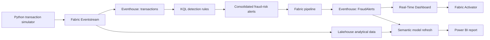

### Microsoft Fabric workspace

The workspace connects the components used for ingestion, querying, orchestration and reporting.

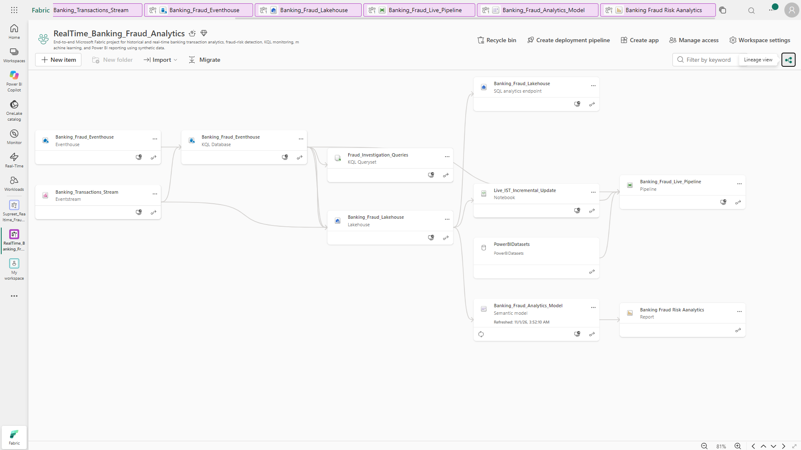

### Eventstream ingestion

Synthetic transactions are streamed into Fabric and made available to the downstream analytical components.

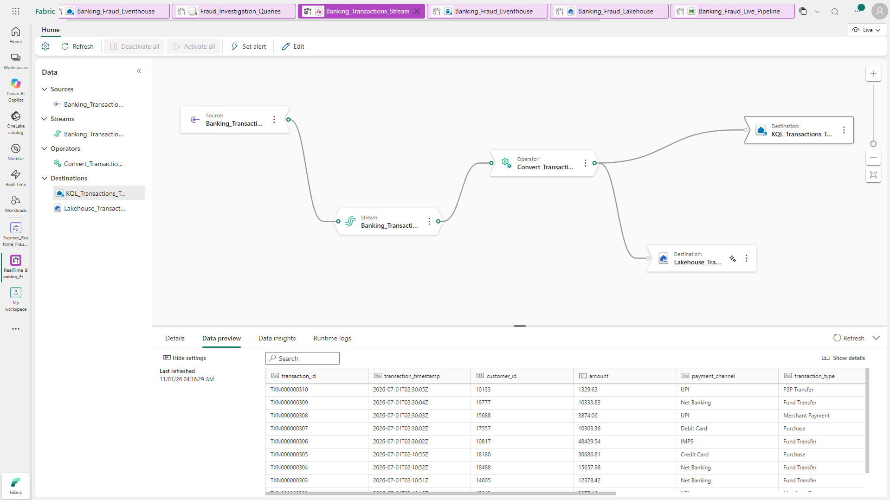

### Data pipeline

The pipeline manages dimension updates, persisted fraud alerts, a **300-second OneLake synchronization wait**, and semantic model refresh. Event ingestion and report refresh are separate operations.

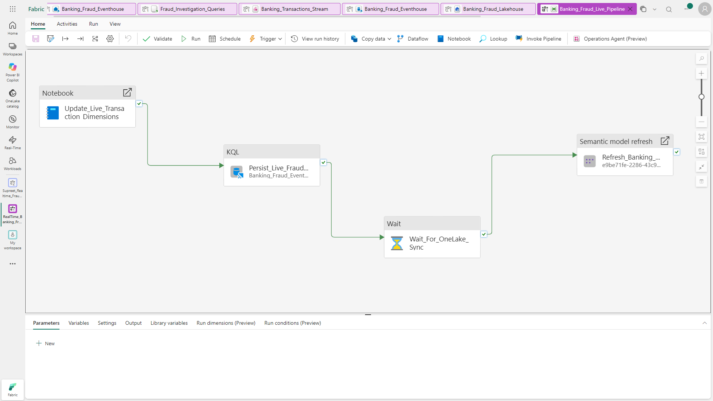

## Fraud detection rules

Five KQL scenarios identify different types of suspicious transaction behavior.

| Scenario | Detection criteria |
|---|---|
| **High Velocity** | Three or more transactions by the same customer within a fixed two-minute window |
| **Spending Burst** | Three or more transactions totaling at least ₹50,000 within 15 minutes |
| **Unusual High Value** | Net Banking fund transfer over ₹25,000 and at least twice the customer's comparable prior average |
| **Unusual Transaction Time** | Activity between 12:00 AM and 5:00 AM IST |
| **Impossible Travel** | Consecutive customer transactions at least 500 km apart within 30 minutes |

The rules assign severity based on their thresholds. When a transaction matches **two or more distinct scenarios**, the consolidated alert is classified as **Critical**. The alert also retains its scenario names and reasons to support investigation.

The detection approach is **rule-based KQL**, rather than predictive machine learning.

[Explore the KQL implementation](kql/README.md) · [Business requirements and rule thresholds](docs/Final_BRD.md)

## Power BI dashboard

**[Watch the Power BI Dashboard Walkthrough (Google Drive)](https://drive.google.com/file/d/1afmKbpVsvYN4aw0UyvNSp5ByAagLn0pO/view?usp=sharing)** | [Video details](videos/README.md)

The recorded walkthrough demonstrates navigation and interactive filtering across the three report pages. The video is hosted externally so it remains accessible independently of the Fabric-hosted report, subject to Google Drive sharing permissions.


The report includes **Fraud Overview**, **Fraud Investigation** and **Risk Patterns**. Each page is shown below for both the historical baseline and the extended synthetic test period.

### 1. Fraud Overview

A summary of transaction volume, flagged activity, alert rate, potential exposure, monthly trends and distribution by channel, transaction type and customer characteristics.

| July–September 2026 | July–November 2026 |
|:---:|:---:|
| 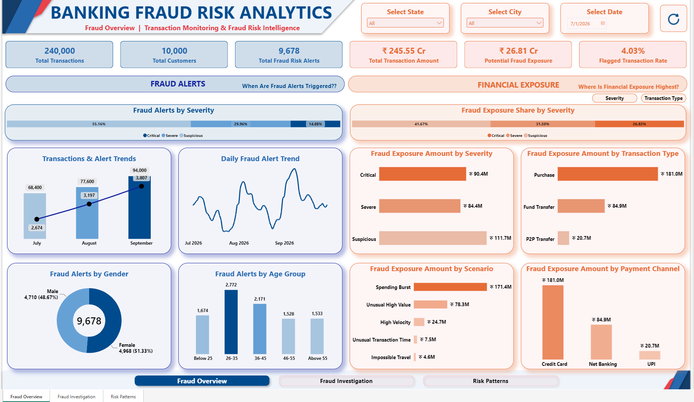 | 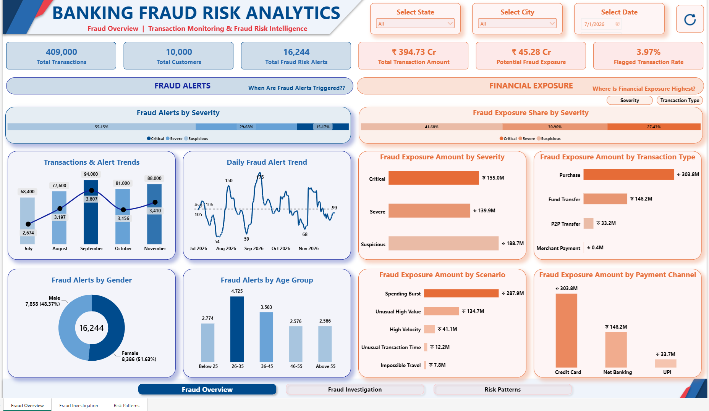 |

**Key finding:** September recorded the most alerts (**3,807**), while August had the highest monthly alert rate (**4.12%**). Normalizing alerts by transaction volume provides a different perspective from counts alone.

### 2. Fraud Investigation

An investigation-focused view of Critical and multi-scenario alerts, scenario-level exposure, alert trends and transaction details. The investigation table brings together customer, transaction, location, payment channel, severity and alert-reason information.

| July–September 2026 | July–November 2026 |
|:---:|:---:|
| 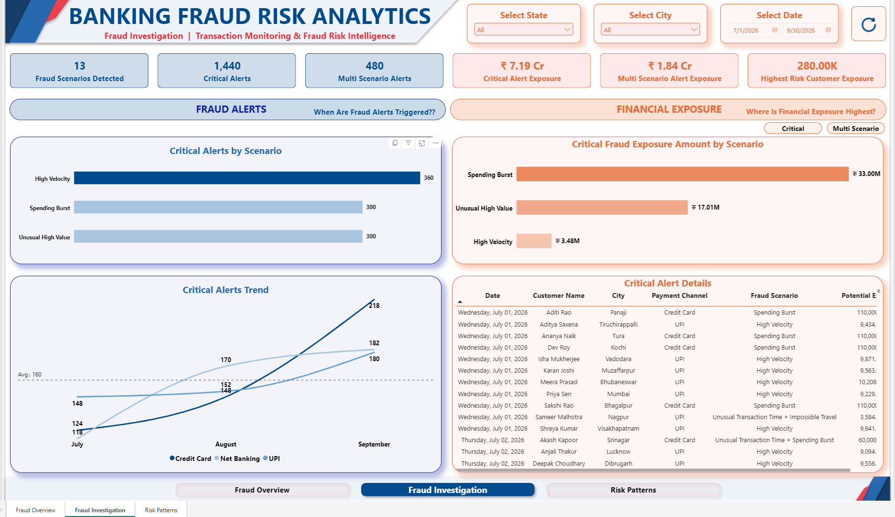 | 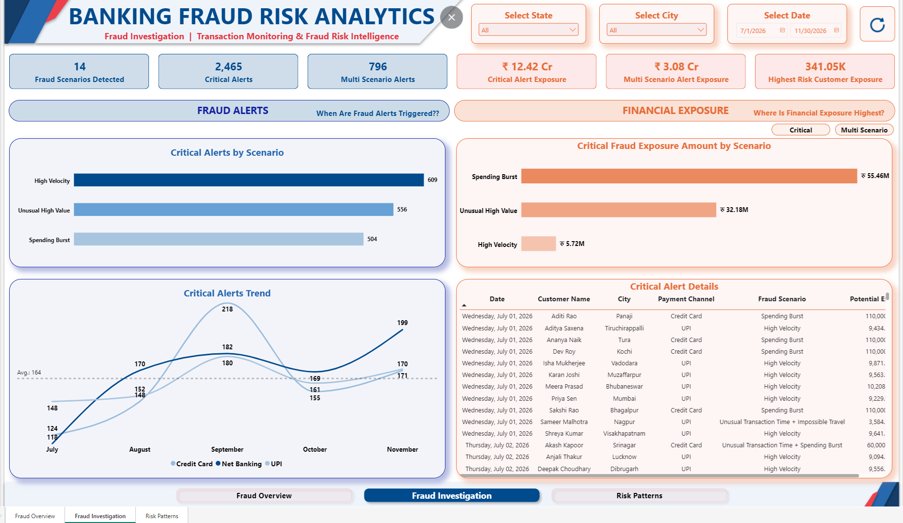 |

**Key finding:** The extended dataset contains **2,465 Critical alerts** and **796 multi-scenario alerts**. Overlapping scenarios are consolidated to support prioritization and reduce duplication at the individual alert level.

### 3. Risk Patterns

A geographic and behavioral view covering state and city rankings, risk maps, hourly activity, customer alert frequency, weekly trends and a scenario-by-channel heatmap.

| July–September 2026 | July–November 2026 |
|:---:|:---:|
| 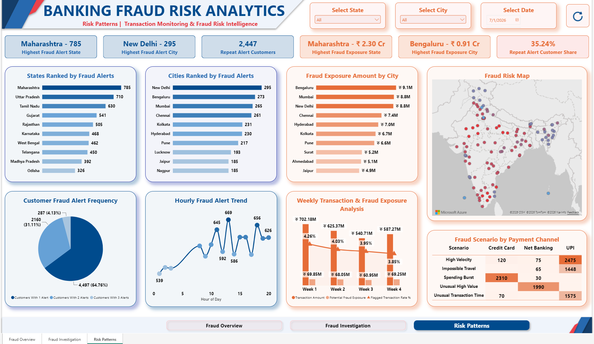 | 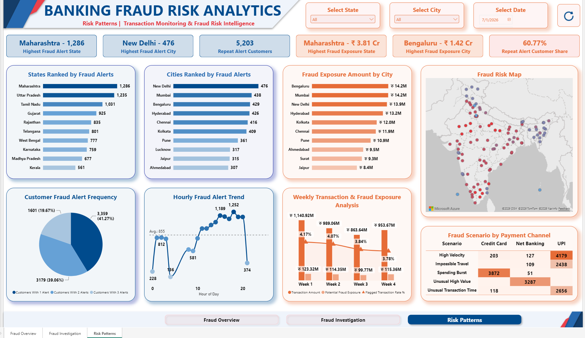 |

**Key finding:** In the extended simulation, **Maharashtra** recorded the highest state alert count (**1,286**), **New Delhi** the highest city alert count (**476**), and **Bengaluru** the highest city-level potential exposure (**₹1.42 Cr**). Alert frequency and monetary exposure highlight different areas of investigation.

## Fabric Real-Time Monitoring Dashboard

The operational dashboard complements Power BI with a **rolling one-hour view** of transactions and alerts. Its KPI cards show transaction count, alerts, Critical alerts, estimated potential exposure and alert rate. The investigation table displays the associated transaction and customer details.

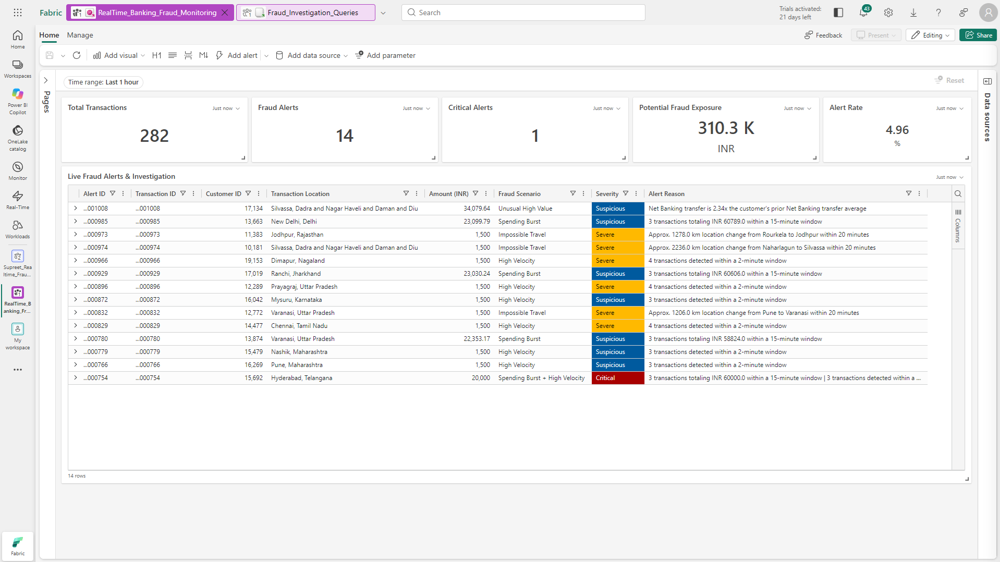

**Captured dashboard view:** **282 transactions**, **14 alerts**, **1 Critical alert**, **₹310.3K** potential exposure and a **4.96%** alert rate. These figures describe the captured one-hour window.

## Business insights

- **Volume versus risk rate:** September had the highest alert count (**3,807**), but August had the highest alert rate (**4.12%**).
- **Channel behavior:** UPI accounted for **44.19%** of baseline transactions but **20.46%** of their value; frequency and monetary value tell different stories.
- **Investigation priority:** **796 multi-scenario alerts** in the extended simulation carry multiple rule-based risk signals for review.
- **Geographic risk:** New Delhi led city-level alert counts (**476**), while Bengaluru led displayed city-level potential exposure (**₹1.42 Cr**).
- **Exposure interpretation:** Category-level exposure figures are not fully reconciled with the headline metric; these are simulated risk estimates, not confirmed losses.

[Explore the full analysis](docs/INSIGHTS.md)

## Implementation highlights

- Built a Python-based simulator for historical and controlled live-mode synthetic transactions.
- Implemented five KQL detection scenarios using time windows, customer history, IST conversion and location-distance calculations.
- Consolidated multiple scenario matches into explainable alerts with severity and exposure information.
- Connected Eventstream, Eventhouse, pipelines, Lakehouse and Power BI into an analytical workflow.
- Designed three Power BI pages and a separate operational monitoring dashboard.

[**Engineering challenges and solutions**](docs/CHALLENGES_AND_LEARNINGS.md)

## Repository structure

| Section | Contents |
|---|---|
| [**Python**](python/README.md) | Transaction simulator, dimension generators and dependencies |
| [**KQL**](kql/README.md) | Fraud-risk detection and alert persistence scripts |
| [**Data**](data/README.md) | Synthetic customer/location dimensions and transaction sample |
| [**Documentation**](docs/README.md) | Business requirements, analysis, implementation notes and validation |
| [**Reports**](reports/README.md) | Power BI report pages and report file status |
| [**Screenshots**](screenshots/README.md) | All ten Power BI and Microsoft Fabric screenshots |

### Running the simulator

```bash
python -m pip install -r python/requirements.txt
python python/RealTime_Banking_Fraud_FINAL.py
```

The simulator supports historical generation and controlled live-mode transactions. Fabric connection settings are required to stream events; credentials are not stored in the repository.

## Acknowledgments

- [**Santosh Avalamurthy**](https://www.linkedin.com/in/santosh-avalamurthy-mct-msfabric-mspowerbi-coach-trainer/) - Microsoft Fabric and Power BI training.
- [**Mansi Goel**](https://www.linkedin.com/in/mansigoelofficial/) - Microsoft Fabric and data analytics tutorials.

## Author

**Supreet Jayant Tarwarkar**

[GitHub](https://github.com/SupreetTarwarkar) | [LinkedIn](https://www.linkedin.com/in/supreettarwarkar/)

---

*Educational implementation using synthetic data. Fraud-risk alerts indicate rules matched, not confirmed fraudulent transactions.*
