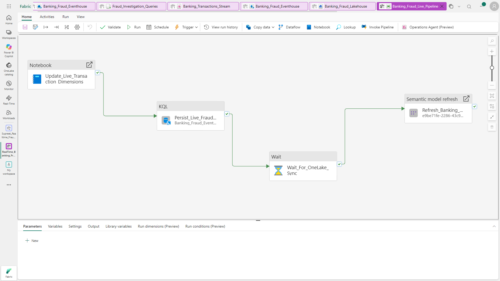

# Engineering Challenges and Solutions

This project connects synthetic event generation, real-time querying, alert consolidation, orchestration and analytical reporting within Microsoft Fabric. The main implementation challenges involved maintaining consistent data, preserving the meaning of fraud-risk rules and separating operational monitoring from historical reporting.

## 1. Generating synthetic transactions

**Challenge:** Produce a sizeable transaction dataset with customer, payment-channel, time and location attributes while keeping all information synthetic.

**Implementation:** A Python simulator supports historical and controlled live-mode generation. Separate scripts generate the customer and location dimensions. The historical baseline contains **240,000 transactions**, **10,000 customers** and **105 Indian locations**.

**Result:** The transaction dataset can be used to test ingestion, rule evaluation and reporting without exposing real customer records.

## 2. Maintaining complete date coverage

**Challenge:** Early simulation runs required corrections to cover the beginning and end of calendar months.

**Implementation:** The final generator includes date-coverage handling for the 1st and the 28th–31st, where applicable, while retaining the transaction schema used by the analytical model.

**Result:** Historical reporting can be organized across complete calendar periods rather than partial date ranges.

## 3. Implementing explainable fraud-risk rules

**Challenge:** Detect different transaction patterns using appropriate customer history, time windows, local time and geographic distance.

**Implementation:** Five KQL scenarios cover **High Velocity, Spending Burst, Unusual High Value, Unusual Transaction Time and Impossible Travel**. The logic uses fixed windows, customer-level comparisons, IST conversion and distance-based checks.

**Result:** Each alert can be associated with a defined rule and an investigation reason rather than an opaque model score.

[View detection KQL](../kql/06_Final_FraudAlerts_Updated.kql)

## 4. Handling overlapping scenarios

**Challenge:** A single transaction may satisfy more than one detection rule. Treating each match independently can complicate severity classification and exposure reporting.

**Implementation:** KQL consolidates distinct scenario matches, retains their reasons and escalates events matching **two or more scenarios** to **Critical**. Within a consolidated alert, potential exposure is based on the maximum applicable scenario amount rather than adding overlapping scenario amounts.

**Result:** Investigators receive a combined view of the matched rules and a consistent alert-level severity.

## 5. Connecting streaming, persistence and reporting

**Challenge:** Transaction ingestion, KQL detection, alert persistence, OneLake synchronization and Power BI refresh operate at different stages.

**Implementation:** Eventstream routes incoming transactions, Eventhouse provides KQL querying, and a Fabric pipeline coordinates alert persistence and semantic model refresh. A separate Real-Time Dashboard queries the recent operational window.

**Result:** Historical analysis and last-hour monitoring are available as complementary views.

## 6. Designing investigation-oriented reports

**Challenge:** Aggregate KPIs alone do not explain which transaction was flagged or which rule caused the alert.

**Implementation:** The three Power BI pages combine trends, severity, geography, payment channels and transaction-level investigation fields. A separate Real-Time Dashboard displays recent alerts and their reasons.

**Result:** The report supports both high-level monitoring and case-level exploration.

[Explore the Power BI pages](../README.md#power-bi-dashboard)

## 7. Metric consistency and validation

**Challenge:** Alert counts, distinct flagged transactions, overlapping scenarios and exposure totals can use different aggregation grains.

**Implementation:** The project documents KPI definitions, validates the historical transaction dataset and compares report-level totals with category breakdowns.

**Current status:** Several extended-report visuals require further reconciliation. These differences still require reconciliation.

## 8. Development tools

Python generation and debugging were completed in **VS Code with ChatGPT assistance**. The project uses deterministic KQL for detection and Power BI for the analytical presentation.

## Technical considerations

- The persistence script uses **`.set-or-replace FraudAlerts`** and rebuilds the target table. Incremental persistence would be required for a production-style extension.
- The **Fabric Activator Critical-alert rule** is configured; successful email delivery has not been verified.
- An ID-level comparison between injected synthetic anomalies and persisted alert records remains a separate validation step.

---

[⬅ Back to Main README](../README.md)
